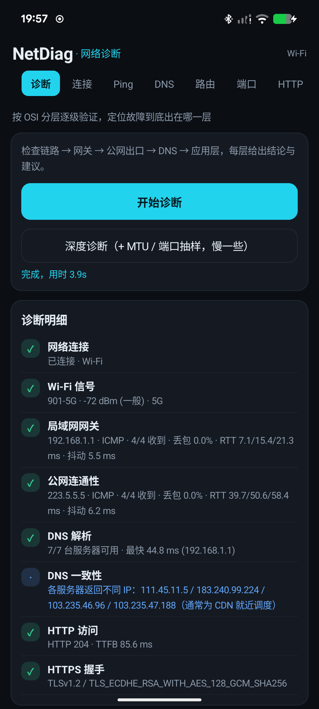
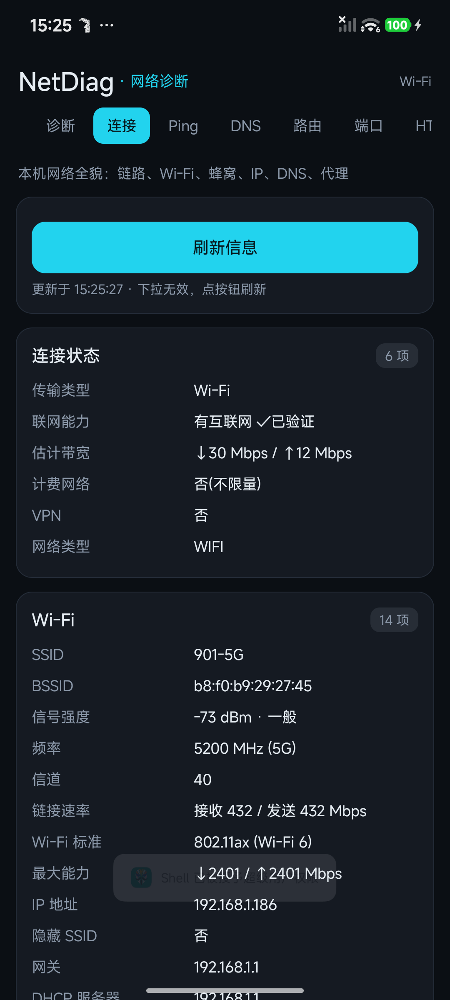
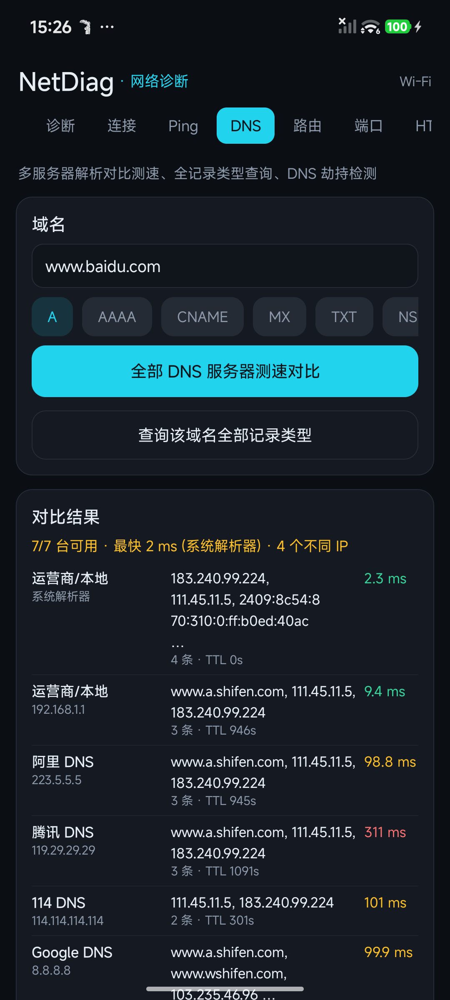
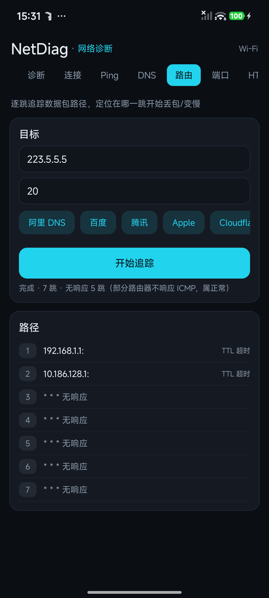
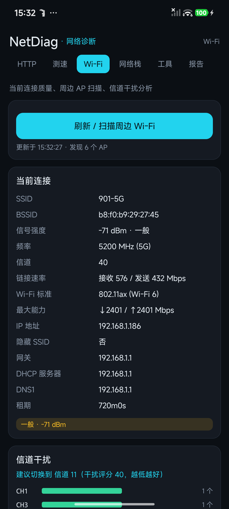
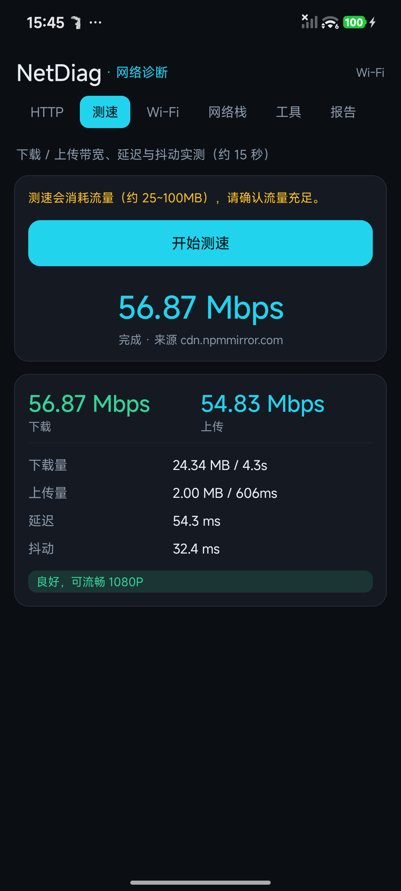

# NetDiag · 安卓网络故障诊断工具

[](https://github.com/cmosakg/netdiag/releases/latest)
[](https://github.com/cmosakg/netdiag/releases/latest)
[](https://github.com/cmosakg/netdiag/releases/latest)

一款纯 Java 实现的安卓网络诊断 App，12 个模块覆盖从链路层到应用层的完整排查链路。核心能力是**按 OSI 分层逐级验证，直接指出故障出在哪一层**，而不是丢一堆数字让人自己判断。

零第三方依赖、零 Gradle、零 AndroidX，全部 UI 由代码构建，APK 85 KB。

## 下载安装

从 [Releases](https://github.com/cmosakg/netdiag/releases/latest) 下载 `netdiag-v1.0.0.apk` 后直接安装。

- 要求 Android 11（API 30）及以上
- 已在 Android 16（HyperOS）与 Android 17（LineageOS）真机验证
- 首次启动需授予位置权限，这是系统读取 Wi-Fi 信息的强制要求（非本应用自行收集）

## 功能

| 模块 | 能力 |
|---|---|
| 诊断 | 按 OSI 分层逐级验证：链路 → 网关 → 公网出口 → DNS → 应用层，输出故障定位层级、健康评分与改进建议 |
| 连接 | 网络类型、Wi-Fi 全参数（SSID/BSSID/RSSI/信道/标准/链路速率/加密方式）、蜂窝（运营商/5G NR/LTE 信号强度 dBm/服务小区）、IPv4·IPv6、DNS 服务器、MTU、私有 DNS、公网出口 IP + 归属 + AS |
| Ping | ICMP 与 TCP Ping 双通道（绕过 ICMP 封锁），输出丢包率、抖动、RTT 最小/平均/最大与质量评级 |
| DNS | 手写 DNS 客户端（UDP 报文自组自解析），支持 A/AAAA/CNAME/MX/TXT/NS/SOA，多服务器并发测速对比、结果一致性检测（识别劫持或 CDN 调度） |
| 路由 | 逐跳路径追踪，含反向解析、逐跳延迟与丢包统计 |
| 端口 | 并发 TCP 端口探测、常见服务识别、开放端口汇总 |
| HTTP | 状态码、建连 / TTFB / 下载分阶段耗时、重定向链、响应头全量、TLS 证书链（颁发者、有效期、签名算法、协商套件与版本） |
| 测速 | 下载 / 上传 / 延迟 / 抖动，多测速源自动降级 |
| Wi-Fi | 周边 AP 扫描、信道占用柱状图、2.4 GHz 最优信道推荐、开放网络告警 |
| 网络栈 | IPv4/IPv6 路由表、ARP 邻居表、TCP 连接、UDP/TCP 监听端口；无 root 时自动降级为应用层视图 |
| 工具 | 路径 MTU 二分探测、出口 IP 查询、常用 DNS 服务器优选排名 |
| 报告 | 一键生成完整文本报告，支持保存文件、系统分享、复制 |

## 截图

| 分层诊断 | 连接信息 | DNS 多服务器对比 |
|---|---|---|
|  |  |  |

| 路由追踪 | Wi-Fi 分析 | 测速 |
|---|---|---|
|  |  |  |

## 构建

不依赖 Gradle，直接走 aapt2 → javac → d8 → zipalign → apksigner 链路，秒级出包。

### 环境要求

- JDK 17+
- Android SDK：`build-tools`（aapt2、zipalign、apksigner、lib/d8.jar）、`platforms/android-36`（android.jar）
- adb（可选，用于自动安装）

### 目录约定

脚本按「工作区根目录」定位工具链，默认结构：

```
<workspace>/
├── netdiag/              # 本工程，脚本所在目录
├── tools/
│   ├── android-16/       # build-tools：aapt2 / zipalign / apksigner / lib/d8.jar
│   ├── android-36/       # platforms：android.jar
│   └── jdk-17.0.21+9/    # 可选，自带 JDK
└── platform-tools/
    └── adb
```

工具链放在别处时，用 `NETDIAG_HOME` 指定根目录即可，或直接修改脚本顶部的路径变量。

### 构建命令

```bash
cd netdiag

./build.sh --no-install   # 只出包
./build.sh                # 出包 + 自动安装到已连接设备 + 授予运行时权限 + 启动
```

产物：`netdiag/build/netdiag.apk`

首次构建若缺失签名密钥，脚本会自动用 `keytool` 生成调试用 keystore。

## 实测数据

在小米 13（LineageOS 24 / Android 17）与 HyperOS（Android 16）上均验证通过，家用移动宽带 + Wi-Fi 5G：

| 项目 | 实测值 |
|---|---|
| 一键诊断耗时 | 3.9 s，健康评分 100 |
| 局域网网关 | 192.168.1.1，4/4 收到，RTT 7.1 / 15.4 / 21.3 ms，抖动 5.5 ms |
| 公网连通性 | 223.5.5.5，0% 丢包，RTT 39.7 / 50.6 / 58.4 ms |
| DNS | 7/7 台服务器可用，最快 44.8 ms（路由器 192.168.1.1） |
| HTTP | 204，TTFB 85.6 ms |
| TLS | TLSv1.2，TLS_ECDHE_RSA_WITH_AES_128_GCM_SHA256 |
| 带宽 | 下载 56.87 Mbps / 上传 54.83 Mbps |
| 路径 MTU | 1480（PPPoE 环境典型值） |
| 出口 IP | 重庆移动，AS9808 |

## 开发踩坑

以下问题在真机验证中都是「界面看起来正常，但结论全错」的隐蔽 bug，记录备查：

1. **默认网关取到 IPv6 链路本地地址**
   `LinkProperties.getRoutes()` 返回的第一个默认路由可能是 IPv6 的 `fe80::`，导致 ping 必然失败，诊断误报「局域网故障」。必须优先筛 `instanceof Inet4Address`，且 fe80 地址 ping 时要补 `%wlan0` scope。

2. **HTTP 探测设置 `Connection: close` 会直接抛异常**
   `Connection` 在 Android 上属于受限请求头，`HttpURLConnection` 视其为不安全而拒绝设置，导致所有 HTTP/TLS 探测失败。删掉即可，连接管理交给系统。

3. **`ping -t TTL` 的 TTL 超时响应格式特殊**
   返回的是 `From 192.168.1.1: icmp_seq=1 Time to live exceeded`——**首字母大写 `From`、且不含 `time=`**。用 `from\s+` 做小写匹配会全部漏掉，traceroute 表现为「每一跳都无响应」。另外统计行的 `0 received` 并不代表该跳没有回包，须按行匹配 `(?i)from\s+(IP)` 计数。IP 末尾的冒号还需剥掉。

4. **`LinkAddress.getValidLifetime()` / `RouteInfo.getMtu()` 是 @SystemApi**
   公开 SDK 下编译不过，需改用 `LinkProperties.getMtu()` 等公开方法。

5. **无 root 时网络栈全空**
   改用 `ConnectivityManager.LinkProperties` 构建「应用层视图」作为兜底，保证非 root 设备也有可用信息。

6. **测速源选择影响巨大**
   Cloudflare 测速端点在境内偏慢，且 `__up` 上传端点返回 404。改用国内 CDN 后数据才可信。另外多轮重连的 TLS 握手会显著拉低平均速度，采样满 3 MB 就应停止重连。

7. **标签容器方向设错导致按钮挤成竖条**
   多个 pill 按钮想排两行时，外层容器必须 `VERTICAL`，内层行才用 `HORIZONTAL`。设反了会把第二行压成一条细竖线。

8. **未锁定屏幕方向**
   诊断类 App 应锁竖屏，否则设备横屏时布局被拉伸铺开。Manifest 加 `screenOrientation="portrait"`。

9. **频繁调用 `su` 会反复弹授权提示**
   改为「普通身份优先执行，仅在输出含 permission denied 时提权」，避免每条命令都触发 Magisk 授权 toast。

## 权限说明

| 权限 | 用途 | 拒绝影响 |
|---|---|---|
| `ACCESS_FINE_LOCATION` | 读取 Wi-Fi SSID/BSSID、扫描周边 AP（系统强制要求） | Wi-Fi 详情与扫描不可用 |
| `READ_PHONE_STATE` | 读取蜂窝网络类型与信号强度 | 蜂窝信息不可用 |
| `NEARBY_WIFI_DEVICES` | Android 13+ 扫描周边 Wi-Fi | Wi-Fi 扫描不可用 |
| `INTERNET` / `ACCESS_NETWORK_STATE` | 网络诊断本身 | 应用无法工作 |

root 权限为**可选增强**：授权后可读取完整路由表、ARP 表与监听端口；不授权时其余 11 个模块功能不受影响。

## 技术栈

- 语言：Java 11（`-source 11 -target 11`）
- minSdk 30 / targetSdk 36
- UI：纯代码构建的原生 View（无 XML 布局、无 AppCompat、无 Compose）
- 依赖：无。仅使用 Android Framework API
- 构建：aapt2 + javac + d8 + apksigner 手工链路
